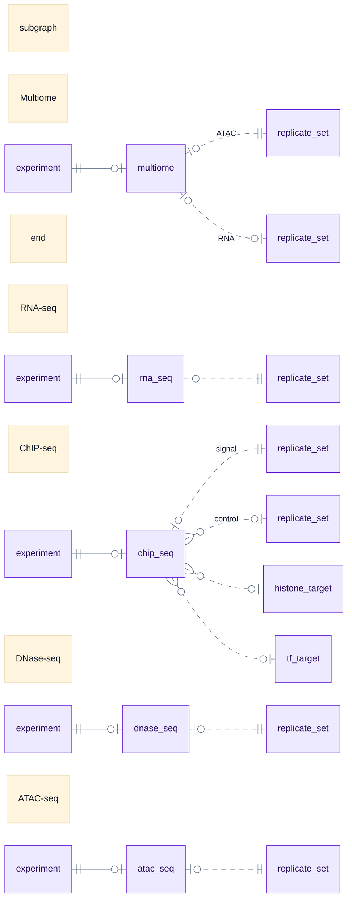
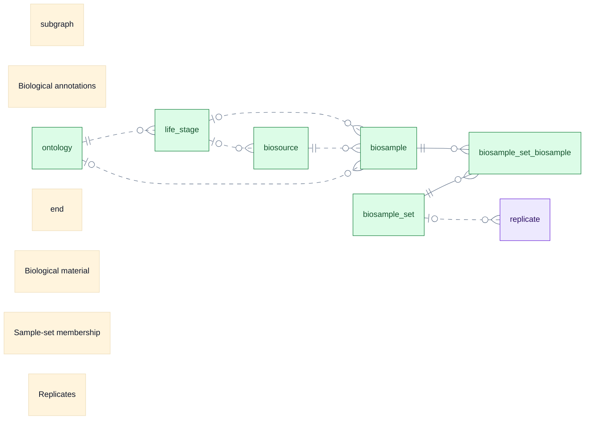
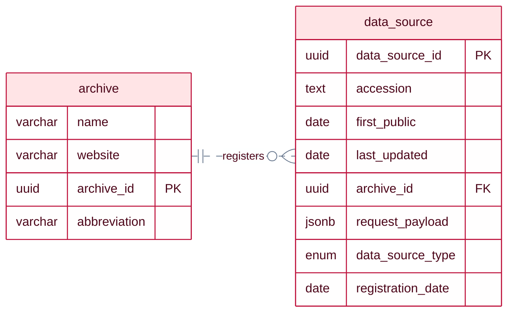
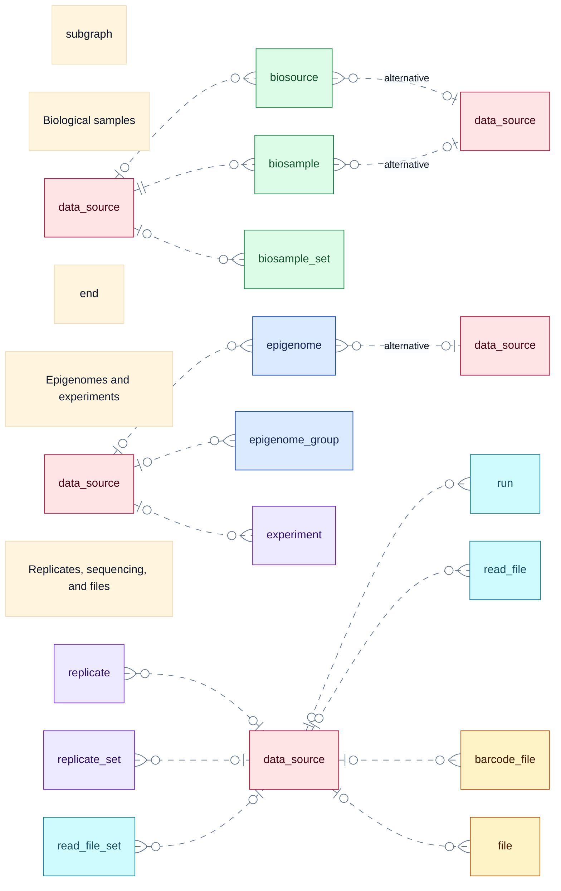
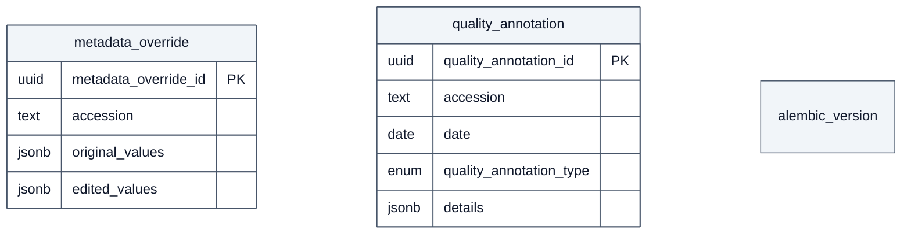

# Regulation Data Registry

The Ensembl Regulation Data Registry (RDR) structures experiment metadata from
public archives, including ENCODE, FAANG, ENA and BioSamples, and provides a
unified way to work with it. It records experiments relevant to Ensembl Regulation
and references their data files rather than duplicating information available
in those files.

The schema supports multiple species and genome assemblies and can accommodate
additional data sources and experiment types. The database is versioned
independently of Ensembl releases so that its schema and contents can evolve
as new data is registered. This repository distributes snapshots that users can
run and query locally, with Git tags identifying specific versions.

### Supported data sources

- [ENCODE](https://www.encodeproject.org/)
- [FAANG Data Portal](https://data.faang.org/home)
- [ENA](https://www.ebi.ac.uk/ena/browser/home)
- [BioSamples](https://www.ebi.ac.uk/biosamples/)

### Supported experiments

The current snapshot contains the following experiment types:

- ATAC-seq
- DNase-seq
- ChIP-seq (histone modifications and transcription factors)

Additional experiment types under development:

- RNA-seq
- Multiome (paired single-nucleus ATAC-seq and RNA-seq)

## Schema overview

Epigenomes group experiments by biological context. Assay-specific tables connect
experiments to sets of replicates; each replicate links sequencing reads to a
set of biological samples. Analysis files associate an experiment with a genome
assembly and a registered file.

```mermaid
---
config:
  theme: base
  layout: dagre
  er:
    minEntityWidth: 80
    minEntityHeight: 40
    entityPadding: 8
    nodeSpacing: 30
    rankSpacing: 55
  themeCSS: |
    .relationshipLabelBox, .relationshipLabelBox rect { opacity: 1; fill: #f8fafc; }
    .labelBkg { background-color: #f8fafc; }
  themeVariables:
    primaryTextColor: '#0f172a'
    textColor: '#0f172a'
    lineColor: '#64748b'
    edgeLabelBackground: '#f8fafc'
    clusterBkg: '#f8fafc'
    clusterBorder: '#94a3b8'
    tertiaryColor: '#f8fafc'
    tertiaryTextColor: '#0f172a'
---
erDiagram
    direction TB
    %% Declare side branches first to keep these tables left of the hierarchy.
    species ||..o{ assembly : ""
    experiment ||..o{ analysis_file : ""
    read_file_set ||..o{ alignment_file : ""

    assembly
    analysis_file
    alignment_file

    subgraph samples ["Biological samples"]
        biosource
        biosample
        biosample_set_biosample
        biosample_set
        biosource ||..o{ biosample : ""
        biosample ||--o{ biosample_set_biosample : ""
        biosample_set_biosample }o--|| biosample_set : ""
    end

    subgraph hierarchy [" "]
        subgraph hierarchy_epigenomes ["Base epigenomes"]
            species
            epigenome
            species ||..o{ epigenome : ""
        end

        subgraph hierarchy_experiments ["Experiments"]
            experiment
            replicate_set
            replicate
            experiment }o..o{ replicate_set : "via assay tables"
            replicate_set ||..o{ replicate : ""
        end

        subgraph hierarchy_sequencing ["Sequencing"]
            read_file_set
            run
            read_file
            read_file_set |o..o{ run : ""
            run |o..o{ read_file : ""
        end

        epigenome ||..o{ experiment : ""
        replicate }o..|| read_file_set : ""
    end

    replicate }o..o| biosample_set : ""
    assembly ||..o{ analysis_file : ""
    assembly ||..o{ alignment_file : ""

    classDef context fill:#dbeafe,stroke:#1d4ed8,color:#172554
    classDef assays fill:#ede9fe,stroke:#6d28d9,color:#2e1065
    classDef samples fill:#dcfce7,stroke:#15803d,color:#14532d
    classDef sequencing fill:#cffafe,stroke:#0e7490,color:#164e63
    classDef resources fill:#fef3c7,stroke:#b45309,color:#451a03
    class species,epigenome,assembly context
    class experiment,replicate_set,replicate assays
    class biosource,biosample,biosample_set,biosample_set_biosample samples
    class read_file_set,run,read_file sequencing
    class alignment_file,analysis_file resources

    overview_key["|| one<br/>o| zero or one<br/>o{ zero or many<br/>— FK in PK<br/>┄ other link"]
    classDef key fill:#f1f5f9,stroke:#475569,color:#0f172a
    class overview_key key
```

Read the main column from top to bottom: species → epigenome → experiment →
replicate set → replicate → read-file set → run → read file.

The overview above shows the main path through the schema. The four expandable
sections below provide more detail about assays, samples, files, and provenance.
Select a section title to see its detailed diagrams. Repeated boxes refer to the same table. Most
boxes show table names only; the provenance section also includes column
definitions. Views are omitted throughout.

<details>
<summary><strong>Assay types and replicate sets</strong></summary>

Each assay has its own group, with `experiment` on the left and replicate sets
and targets on the right. Repeated boxes refer to the same tables, drawn
separately to avoid crossing lines. The signal/control and ATAC/RNA labels
distinguish the roles of replicate sets.



</details>

<details>
<summary><strong>Samples and biological annotations</strong></summary>

The membership table connects sample sets to samples. Life-stage and ontology
links add biological annotations; the optional sample-set link ties samples
to replicates.



</details>

<details>
<summary><strong>Files, locations, and processing</strong></summary>

File-role tables share the generic `file` registry. Locations are recorded
separately. The `run_alignment_task` membership table connects runs and alignment
tasks; an alignment file can optionally identify its task. Shared tables are
repeated inside labeled compartments to keep the relationships separate.

```mermaid
---
config:
  theme: base
  layout: dagre
  er:
    rankSpacing: 90
    nodeSpacing: 40
  themeCSS: |
    .relationshipLabelBox, .relationshipLabelBox rect { opacity: 1; fill: #f8fafc; }
    .labelBkg { background-color: #f8fafc; }
  themeVariables:
    primaryTextColor: '#0f172a'
    textColor: '#0f172a'
    lineColor: '#64748b'
    edgeLabelBackground: '#f8fafc'
    clusterBkg: '#f8fafc'
    clusterBorder: '#94a3b8'
    tertiaryColor: '#f8fafc'
    tertiaryTextColor: '#0f172a'
---
erDiagram
    direction LR
    subgraph files_reference ["Reference assemblies"]
        direction LR
        reference_left_0["species"]
        reference_assembly["assembly"]
        reference_right_0["file"]
        reference_left_0 ||..o{ reference_assembly : ""
        reference_assembly }o..|| reference_right_0 : ""
    end

    subgraph files_alignment ["Alignment files"]
        direction LR
        aligned_left_0["read_file_set"]
        aligned_left_1["assembly"]
        aligned_left_2["alignment_task"]
        aligned_alignment_file["alignment_file"]
        aligned_right_0["file"]
        aligned_left_0 ||..o{ aligned_alignment_file : ""
        aligned_left_1 ||..o{ aligned_alignment_file : ""
        aligned_left_2 |o..o{ aligned_alignment_file : ""
        aligned_alignment_file }o..|| aligned_right_0 : ""
    end

    subgraph files_analysis ["Analysis files"]
        direction LR
        analysis_left_0["experiment"]
        analysis_left_1["assembly"]
        analysis_analysis_file["analysis_file"]
        analysis_right_0["file"]
        analysis_left_0 ||..o{ analysis_analysis_file : ""
        analysis_left_1 ||..o{ analysis_analysis_file : ""
        analysis_analysis_file }o..|| analysis_right_0 : ""
    end

    subgraph files_masks ["Mask files"]
        direction LR
        masks_left_0["assembly"]
        masks_mask_file["mask_file"]
        masks_right_0["file"]
        masks_left_0 ||..o{ masks_mask_file : ""
        masks_mask_file }o..|| masks_right_0 : ""
    end

    subgraph files_barcodes ["Barcode files"]
        direction LR
        barcodes_left_0["run"]
        barcodes_barcode_file["barcode_file"]
        barcodes_right_0["file"]
        barcodes_left_0 ||..o{ barcodes_barcode_file : ""
        barcodes_barcode_file }o..|| barcodes_right_0 : ""
    end

    subgraph files_inclusion ["Inclusion lists"]
        direction LR
        inclusion_file["file"]
        inclusion_list["inclusion_list"]
        inclusion_file ||..o{ inclusion_list : ""
    end

    subgraph files_storage ["File locations"]
        direction LR
        storage_file["file"]
        storage_s3["s3_object"]
        storage_bucket["bucket"]
        storage_posix["posix_file"]
        storage_url["public_url"]
        storage_file ||..o{ storage_s3 : ""
        storage_s3 }o..|| storage_bucket : ""
        storage_file ||..o{ storage_posix : ""
        storage_file ||..o{ storage_url : ""
    end

    subgraph files_tasks ["Run and alignment-task membership"]
        direction LR
        tasks_left_0["run"]
        tasks_run_alignment_task["run_alignment_task"]
        tasks_right_0["alignment_task"]
        tasks_left_0 ||--o{ tasks_run_alignment_task : ""
        tasks_run_alignment_task }o--|| tasks_right_0 : ""
    end


    classDef context fill:#dbeafe,stroke:#1d4ed8,color:#172554
    class reference_left_0 context
    classDef assays fill:#ede9fe,stroke:#6d28d9,color:#2e1065
    class analysis_left_0 assays
    classDef sequencing fill:#cffafe,stroke:#0e7490,color:#164e63
    class aligned_left_0,aligned_left_2,barcodes_left_0,tasks_run_alignment_task,tasks_left_0,tasks_right_0 sequencing
    classDef resources fill:#fef3c7,stroke:#b45309,color:#451a03
    class reference_assembly,reference_right_0,aligned_alignment_file,aligned_left_1,aligned_right_0,analysis_analysis_file,analysis_left_1,analysis_right_0,masks_mask_file,masks_left_0,masks_right_0,barcodes_barcode_file,barcodes_right_0,inclusion_file,inclusion_list,storage_file,storage_s3,storage_bucket,storage_posix,storage_url resources
```



</details>

<details>
<summary><strong>Provenance, curation, and schema version</strong></summary>

Archive accessions are recorded in `data_source`. The native entity-relationship
boxes show column names, SQL types, and primary/foreign keys (`PK` / `FK`);
`enum` denotes a PostgreSQL enumeration.

**Archive accessions**



**Record provenance**

The compact map repeats `data_source` without its columns to keep relationships
readable.



**Curation and schema version**

These tables have no foreign keys. `metadata_override` and `quality_annotation`
identify records by accession; `alembic_version` stores the schema migration
version. Their separate boxes do not imply relationships.



</details>

## Run a local database

You need Git, Make, a POSIX shell, and either:

- [Podman](https://podman.io/docs/installation) 6+ with [podman-compose](https://github.com/containers/podman-compose) 1.6+; or
- Docker with Compose v2.

Start your container engine first. On macOS, Podman needs a VM:

```bash
podman machine init     # Once, after installing Podman
podman machine start
```

Then clone and start RDR:

```bash
git clone https://gitlab.ebi.ac.uk/ensreg/rdr
cd rdr
make db-up
```

This downloads the snapshot, builds PostgreSQL, waits for initialization, and
prints connection details. No bucket credentials, local DVC installation, or
`.env` file are needed.

Connect with your preferred PostgreSQL client:

| Setting | Default |
| --- | --- |
| Host | `127.0.0.1` |
| Port | `2345` |
| Database | `rdr` |
| User | `ensreg-usr` |
| Password | `rdr-local-password` |

Or open `psql` using the container, with the default credentials:

```bash
./scripts/container.sh compose -p rdr exec db psql -U ensreg-usr -d rdr
```

Copy `.env.example` to `.env` to override settings. Commands prefer Podman when
installed; use `CONTAINER_ENGINE=docker make db-up` to select Docker explicitly.
Use the same engine for subsequent commands.

When finished:

```bash
make db-down
```

The database is disposable: stopping or removing the container discards local
changes. See [Development](#development) to export changes before stopping.

### Choose a snapshot

Check out the desired Git tag or commit before running `make db-up`.
When switching an existing instance, run `make db-down` before changing revisions.

## Development

### Export and publish changes

After editing the local database, export both schema and data:

```bash
make db-dump
```

`db/schema.sql` contains the schema and is tracked in Git. `db/data.sql` contains
only table data and sequence values and is tracked by DVC. The export creates one
temporary archive and extracts both SQL files from the same database snapshot.
Initialization loads the schema first, followed by the data in PostgreSQL's
dependency-safe dump order. Use the matching PostgreSQL 14 client and server
images supplied by the container setup.

Export does not run a second database. Before publishing, validate the SQL files:

```bash
make db-validate
```

Validation restores the SQL files into a disposable database without publishing a
port. After reviewing the schema and validation result, update the single pointer:

```bash
make db-data-track
./scripts/dvc.sh status
```

To upload data, configure your bucket write credentials in Git-ignored
`.dvc/config.local`:

```ini
['remote "ensreg-git-lfs"']
    access_key_id = <your-access-key>
    secret_access_key = <your-secret-key>
```

```bash
chmod 600 .dvc/config.local
make db-data-push
```

Commit `db/schema.sql` and `db/data.sql.dvc` together. Exporting, validating,
and uploading data do not create Git commits. Exports are staged before replacing
the previous files. An export may produce a new dump hash even when rows have
not changed: PostgreSQL includes random restriction keys and version comments,
and row order can change. Restriction protection is retained; byte-for-byte
reproducibility is not promised.

Use `make db-dump` to keep the schema and data together.
Apply changes to the local database and export them. The next fresh instance
loads the Git-versioned schema and DVC-versioned data.

Upload new data objects before sharing Git commits that reference them. This
format starts a fresh DVC baseline: obsolete snapshot objects have been purged.
Earlier Git revisions retain their pointers, but their snapshots can no longer
be pulled from the remote.

### Update schema documentation

With the local database running, regenerate the HTML and relationship diagrams:

```bash
make db-up           # If the database is not already running
make schemaspy-docs
```

This uses the pinned SchemaSpy 7.0.2 container with its bundled PostgreSQL driver
and Graphviz; no local Java installation is needed. It reads the `public` schema
from the current local database, including any schema changes you have applied.
It uses the same engine, `DB_PROJECT`, and `.env` connection settings as the
database commands. It waits for PostgreSQL without restarting the database.

Generation replaces `docs/schemaspy/` only after succeeding, removing obsolete
pages for dropped tables. Failed generation preserves the existing docs. Row
counts are omitted so the documentation focuses on the schema. The container
runs with your user ID so generated files remain editable.

Preview locally:

```bash
python3 -m http.server 8000 --bind 127.0.0.1 --directory docs
```

Open <http://localhost:8000/schemaspy/>. Review and commit `docs/schemaspy/`
alongside the corresponding `db/schema.sql` changes after `make db-dump`.

### Tooling

Container configuration and the locked DVC environment live in `containers/`.
Use `make dvc-build` to rebuild with base-image updates, and `./scripts/dvc.sh -h`
for DVC wrapper usage. Run workflow tests with `python3 -m unittest discover -s tests`.

## License

[Apache License 2.0](LICENSE).
