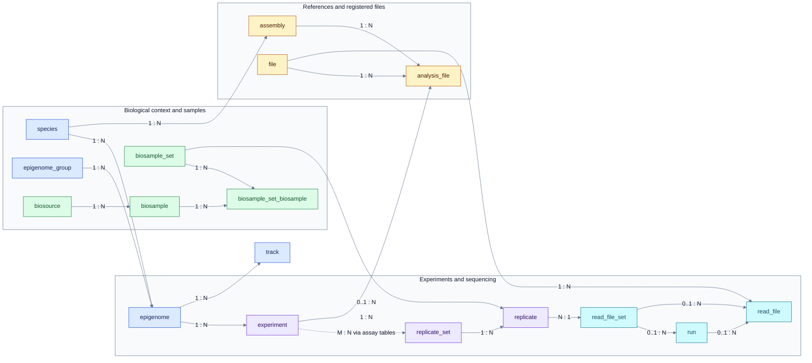
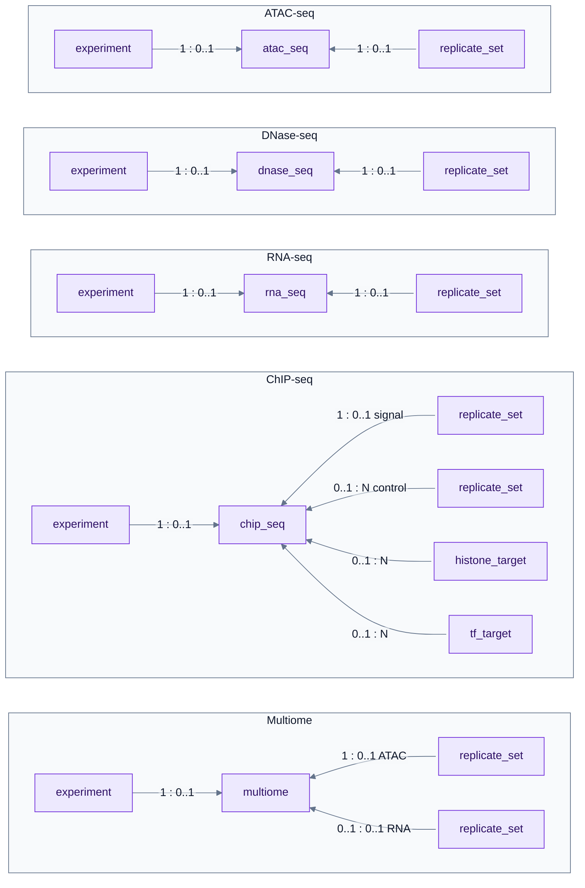
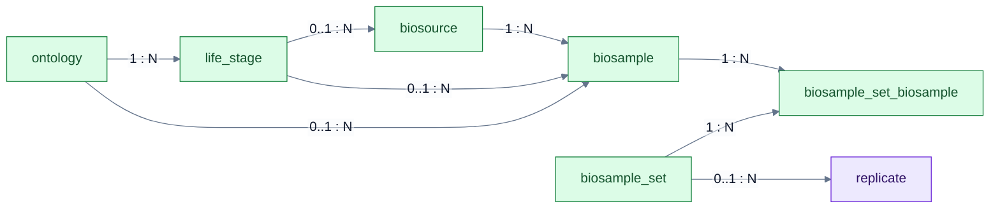
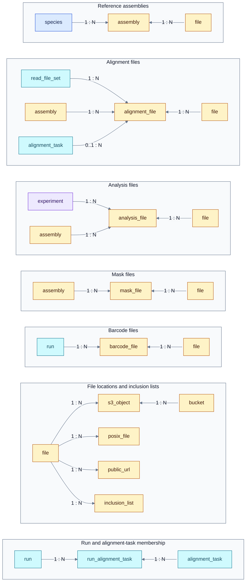
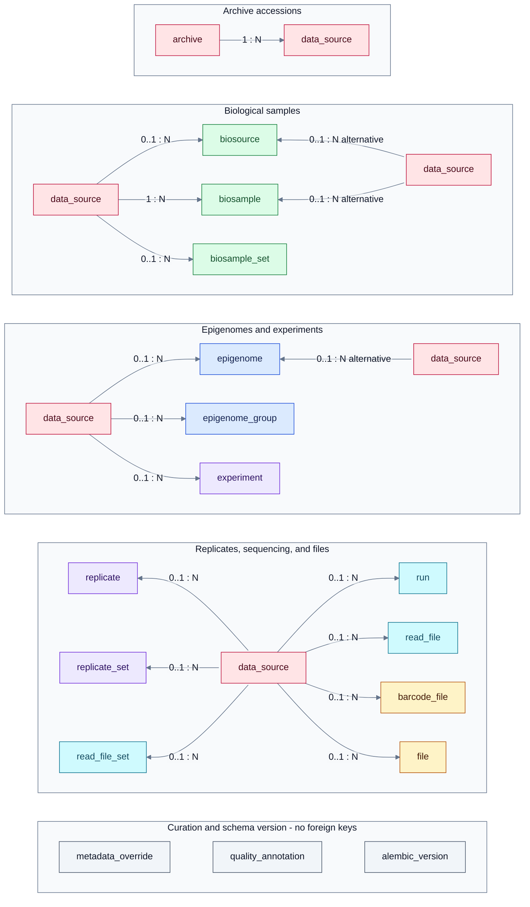

# Regulation Data Registry

The Ensembl Regulation Data Registry (RDR) structures experiment metadata from
public archives, including ENCODE, FAANG, ENA and BioSamples, and provides a
unified way to work with it. It records experiments relevant to Ensembl Regulation
and references their data files rather than duplicating information available
in those files.

The schema supports multiple species and genome assemblies and can accommodate
additional data sources and experiment types. The database is versioned
independently of Ensembl releases so that its schema and contents can evolve
as new data is registered. This repository distributes snapshots that users can
run and query locally, with Git tags identifying specific versions.

### Supported data sources

- [ENCODE](https://www.encodeproject.org/)
- [FAANG Data Portal](https://data.faang.org/home)
- [ENA](https://www.ebi.ac.uk/ena/browser/home)
- [BioSamples](https://www.ebi.ac.uk/biosamples/)

### Supported experiments

The current snapshot contains the following experiment types:

- ATAC-seq
- DNase-seq
- ChIP-seq

## Schema overview

Epigenomes group experiments by biological context. Assay-specific tables connect
experiments to sets of replicates; each replicate links sequencing reads to a
set of biological samples. Analysis files associate an experiment with a genome
assembly and a registered file.



Follow the main chain from left to right: biological context → experiment →
replicates → read-file set → sequencing run → read file. Blue marks biological
context, purple experiments and replicates, green samples, cyan sequencing, and
amber references and files.

Each label gives the cardinality at the source and destination: `1 : N` means
one-to-many, `N : 1` means many-to-one, and `M : N` means many-to-many. Here,
`N` and `M` allow zero or more rows; `0..1` marks an optional parent. For example,
each replicate references exactly one read-file set, but a read file can have no
run assigned. The sample-set membership table implements the many-to-many
relationship between `biosample_set` and `biosample`.

The overview above shows the main path through the schema. Together with the
four expandable sections below, it covers all 41 tables. Select a section title
to see its detailed diagram. Repeated boxes refer to the same table.

Solid arrows show foreign-key relationships, oriented for reading rather than
foreign-key direction. The dotted arrow in the overview summarizes the link
through the assay tables; it is not a direct foreign key. Cardinalities follow
each arrow from tail to head, including arrows pointing left. Columns and views
are omitted.

<details>
<summary><strong>Assay types and replicate sets</strong></summary>

Each assay has its own row, with `experiment` on the left and replicate sets
and targets on the right. Repeated boxes refer to the same tables, drawn
separately to avoid crossing arrows. Labels use
the same cardinality notation as the other diagrams; signal/control and ATAC/RNA
distinguish the roles of replicate sets. Cardinalities follow the arrow from
tail to head, including arrows pointing left.



</details>

<details>
<summary><strong>Samples and biological annotations</strong></summary>

The membership table connects sample sets to samples. Life-stage and ontology
links add biological annotations; the optional sample-set link ties samples
to replicates.



</details>

<details>
<summary><strong>Files, locations, and processing</strong></summary>

File-role tables share the generic `file` registry. Locations are recorded
separately. The `run_alignment_task` membership table connects runs and alignment
tasks; an alignment file can optionally identify its task. Shared tables are
repeated across rows to keep the relationships separate.



</details>

<details>
<summary><strong>Provenance, curation, and schema version</strong></summary>

Archive accessions are recorded in `data_source` and referenced by the tables
shown below. Pink marks provenance. The gray tables have no foreign keys:
`metadata_override` and `quality_annotation` identify records by accession,
while `alembic_version` stores the schema migration version.



</details>

## Run a local database

You need Git, Make, a POSIX shell, and either:

- [Podman](https://podman.io/docs/installation) 6+ with [podman-compose](https://github.com/containers/podman-compose) 1.6+; or
- Docker with Compose v2.

Start your container engine first. On macOS, Podman needs a VM:

```bash
podman machine init     # Once, after installing Podman
podman machine start
```

Then clone and start RDR:

```bash
git clone https://gitlab.ebi.ac.uk/ensreg/rdr
cd rdr
make db-up
```

This downloads the snapshot, builds PostgreSQL, waits for initialization, and
prints connection details. No bucket credentials, local DVC installation, or
`.env` file are needed.

Connect with your preferred PostgreSQL client:

| Setting | Default |
| --- | --- |
| Host | `127.0.0.1` |
| Port | `2345` |
| Database | `rdr` |
| User | `ensreg-usr` |
| Password | `rdr-local-password` |

Or open `psql` using the container, with the default credentials:

```bash
./scripts/container.sh compose -p rdr exec db psql -U ensreg-usr -d rdr
```

Copy `.env.example` to `.env` to override settings. Commands prefer Podman when
installed; use `CONTAINER_ENGINE=docker make db-up` to select Docker explicitly.
Use the same engine for subsequent commands.

When finished:

```bash
make db-down
```

The database is disposable: stopping or removing the container discards local
changes. See [Development](#development) to export changes before stopping.

### Choose a snapshot

Check out the desired Git tag or commit before running `make db-up`.
When switching an existing instance, run `make db-down` before changing revisions.

## Development

### Export and publish changes

After editing the local database, export both schema and data:

```bash
make db-dump
```

`db/schema.sql` contains the schema and is tracked in Git. `db/data.sql` contains
only table data and sequence values and is tracked by DVC. The export creates one
temporary archive and extracts both SQL files from the same database snapshot.
Initialization loads the schema first, followed by the data in PostgreSQL's
dependency-safe dump order. Use the matching PostgreSQL 14 client and server
images supplied by the container setup.

Export does not run a second database. Before publishing, validate the SQL files:

```bash
make db-validate
```

Validation restores the SQL files into a disposable database without publishing a
port. After reviewing the schema and validation result, update the single pointer:

```bash
make db-data-track
./scripts/dvc.sh status
```

To upload data, configure your bucket write credentials in Git-ignored
`.dvc/config.local`:

```ini
['remote "ensreg-git-lfs"']
    access_key_id = <your-access-key>
    secret_access_key = <your-secret-key>
```

```bash
chmod 600 .dvc/config.local
make db-data-push
```

Commit `db/schema.sql` and `db/data.sql.dvc` together. Exporting, validating,
and uploading data do not create Git commits. Exports are staged before replacing
the previous files. An export may produce a new dump hash even when rows have
not changed: PostgreSQL includes random restriction keys and version comments,
and row order can change. Restriction protection is retained; byte-for-byte
reproducibility is not promised.

Use `make db-dump` to keep the schema and data together.
Apply changes to the local database and export them. The next fresh instance
loads the Git-versioned schema and DVC-versioned data.

Upload new data objects before sharing Git commits that reference them. This
format starts a fresh DVC baseline: obsolete snapshot objects have been purged.
Earlier Git revisions retain their pointers, but their snapshots can no longer
be pulled from the remote.

### Update schema documentation

With the local database running, regenerate the HTML and relationship diagrams:

```bash
make db-up           # If the database is not already running
make schemaspy-docs
```

This uses the pinned SchemaSpy 7.0.2 container with its bundled PostgreSQL driver
and Graphviz; no local Java installation is needed. It reads the `public` schema
from the current local database, including any schema changes you have applied.
It uses the same engine, `DB_PROJECT`, and `.env` connection settings as the
database commands. It waits for PostgreSQL without restarting the database.

Generation replaces `docs/schemaspy/` only after succeeding, removing obsolete
pages for dropped tables. Failed generation preserves the existing docs. Row
counts are omitted so the documentation focuses on the schema. The container
runs with your user ID so generated files remain editable.

Preview locally:

```bash
python3 -m http.server 8000 --bind 127.0.0.1 --directory docs
```

Open <http://localhost:8000/schemaspy/>. Review and commit `docs/schemaspy/`
alongside the corresponding `db/schema.sql` changes after `make db-dump`.

### Tooling

Container configuration and the locked DVC environment live in `containers/`.
Use `make dvc-build` to rebuild with base-image updates, and `./scripts/dvc.sh -h`
for DVC wrapper usage. Run workflow tests with `python3 -m unittest discover -s tests`.

## License

[Apache License 2.0](LICENSE).
